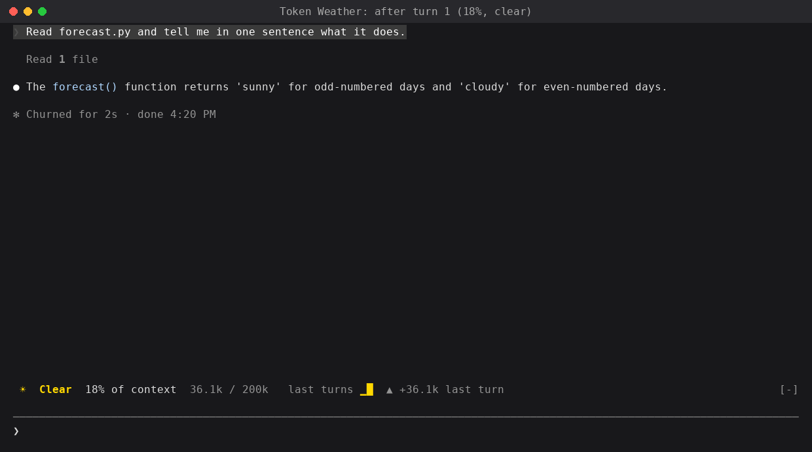
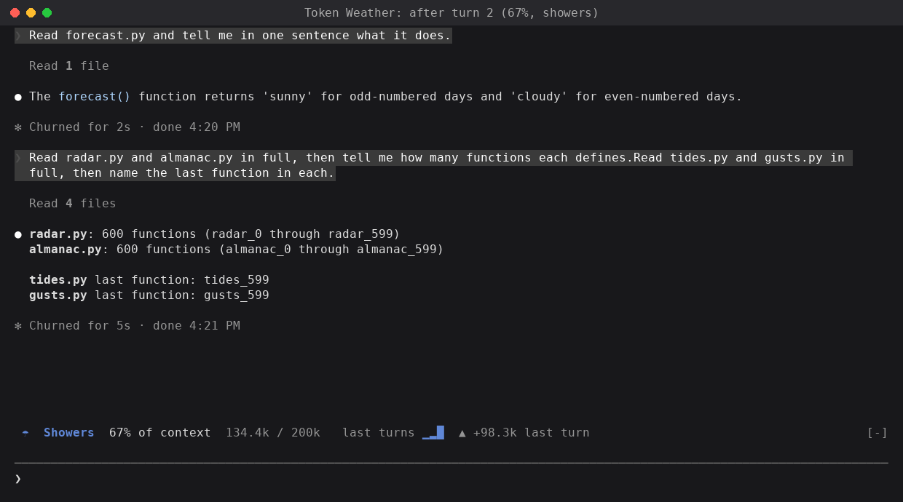
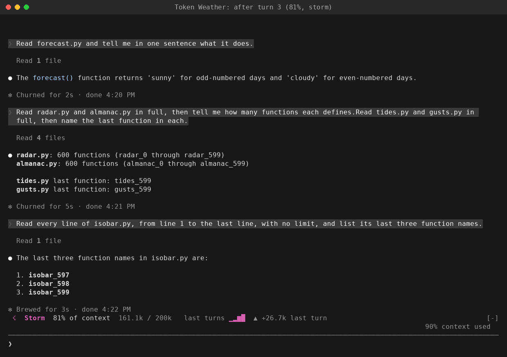

# Token Weather

A Claude Code mod that draws a live forecast of your context window in the band above the prompt. We're sharing it as the smallest of the three mods here: one hooks module that reads real usage figures and draws one line of UI.

> **This fork** (from [anthropics/claude-code-playground](https://github.com/anthropics/claude-code-playground) `claude-code/mods/token-weather`) adds a [handoff](#handoff): past a threshold you set it tells you to hand off, and `/handoff` moves the work to a fresh conversation, so a long session stops re-reading a huge context on every turn.

## What this shows

```text
 ☂  Showers  67% of context  134.4k / 200k   last turns ▁▂█  ▲ +98.3k last turn
```

After each turn, the band shows:

- a weather icon and word for how full the window is,
- the percentage used, and the tokens used out of the window,
- a chart of the last 12 turns, drawn with block characters, and
- how much the last turn added.

| Used      | Forecast          |
|-----------|-------------------|
| under 25% | ☀ Clear           |
| 25–49%    | ☁ Cloudy          |
| 50–74%    | ☂ Showers         |
| 75–89%    | ☇ Storm           |
| 90% up    | ↯ Compact soon    |

The numbers are real, not estimated. After each main-loop turn, the mod calls `$.session.usage()` and reads `context`:

- `tokens`: the input tokens the last response was answered over (uncached, cache-written and cache-read together),
- `window`: the context window of the session's model, and
- `percent`: `tokens` over `window`.

These are the same figures the status line shows (`total_input_tokens`, `context_window_size`, `used_percentage`). The call is free, because the mod doesn't ask for a breakdown, so it sends no token-count request.

| Hook | What it does |
|------|--------------|
| `session.start` | Takes a first reading, so the band shows before the first turn. |
| `turn.complete` | Takes a reading after each main-loop turn. Subagent turns are skipped. |
| `ui.render` with `{component: "AbovePrompt"}` | Draws the band as one line. |

## Handoff

| Command | What it does |
|---------|--------------|
| `/handoff at 60%` | Warn at 60% of the context window. Any whole percent from 1 to 99. |
| `/handoff at 200k` | Warn at a token count instead (`200k`, `1.5m`, `150000`). On a 1M window this is the better measure of cost. |
| `/handoff at off` | No warning. |
| `/handoff status` | The threshold and the window's fill now. |
| `/handoff` | Hand off now. |

The threshold is kept across sessions; it starts at 60%. Past it, the band reads `↪ Time to hand off … /handoff`, a toast fires once per conversation, and `/handoff` is offered as the prompt suggestion.

`/handoff` asks a fork of the conversation for a handoff note (goal, state, decisions, dead ends, next step). The fork reuses the conversation's prompt cache, so the note costs a cache read and a few hundred output tokens. The mod then runs `/clear` and puts the note in the fresh conversation's prompt box, to send as it is or edit first. If the note can't be written, nothing is cleared. If the `/clear` doesn't run, the toast says so, and the next `/clear` you run delivers the note.

## Demo

After the first turn, 18% full:



After reading four large files, 67% full:



After one more file, 81% full. Claude Code's own notice reads 90%, because it counts toward the auto-compact point (see the limitations):



## How it was built

- **Model:** built with Claude in Claude Code. The test runs and screenshots used Claude Haiku 4.5, because its 200k window shows the forecast change within a few turns. The mod itself doesn't call a model.
- **Prompt(s):** the mod started as one of ten ideas Claude wrote for mods. This is the idea as written:

  > **Token Weather.** _A live forecast of your context window._ A band above the prompt draws a small chart of context use for each turn, as weather icons. It's clear when the window is mostly empty, and stormy when it's nearly full. It uses `ui.render` on the `AbovePrompt` component, with the `Svg` element, and it updates on `turn.complete`. I haven't confirmed which event or call gives the token counts, so that needs a check. Developers would share it because it looks good in a screenshot, and it answers "why did Claude forget that?" at a glance. The status line only shows text. _A weekend build._

  The build prompt, which picked this idea and two others by number:

  > implement 1,2,7. give me zips for them. test them in claude code and get me screenshots of what they look like when used.

- **Transcript:** not shared. The build ran in an internal workspace.
- **Iterations:**
  - The idea left open where the token counts come from. The build found `$.session.usage()`, which returns the same figures as the status line, so the mod shows real numbers rather than an estimate.
  - The idea drew the chart with the `Svg` element. The terminal can't draw `Svg`, so the chart is a row of block characters.
  - The first icons were emoji, which weren't in the test terminal's font. The mod uses single-width text symbols instead, which line up in any terminal font.
  - Tested in Claude Code on a test repo of five 42 KB source files: three turns, each reading more files, moved the band from ☀ 18%, to ☂ 67%, to ☇ 81%.

## Run it

**Requirements:**

- Claude Code 2.1.287 or later, where mods load by default. The mod was built and tested on 2.1.280, and `claude plugin validate` passes on 2.1.285.
- A terminal. `AbovePrompt` is drawn on the terminal surface only.

No environment variables or configuration.

**Steps:**

1. Clone this repository and go to this folder's parent:

   ```bash
   git clone https://github.com/anthropics/claude-code-playground.git
   cd claude-code-playground/claude-code/mods
   ```

2. Check the plugin:

   ```bash
   claude plugin validate ./token-weather
   ```

3. Try it for one session:

   ```bash
   claude --plugin-dir ./token-weather
   ```

   Or install it from the marketplace in this folder:

   ```bash
   claude plugin marketplace add ./token-weather
   claude plugin install token-weather@santi-token-weather --scope user
   ```

4. Work as normal. The band updates after each turn.

## Notes / limitations

- **The percentage is of the full window.** Claude Code's own "context used" notice counts against the auto-compact point, which is lower, so the two can differ. In testing, the band read 81% when the notice read 90%.
- **The band updates once per turn**, not during a turn.
- **The chart's bars are relative** to the fullest turn shown, so growth shows even at low fill. The percentage is the absolute figure.
- **The history resets** when the session starts, or when the plugin reloads.
- **On a 1M-token window**, ordinary work stays at ☀ for a long time. That's accurate.
- **It shares the band.** What other plugins draw above the prompt is stacked beneath this line. On a narrow terminal the line drops its trend, chart and token count, in that order, before it would wrap.
- **The note rides the `/clear`.** Claude Code's built-in security plugin keeps user-installed plugins out of the classic `SessionStart` event, so the mod hands the note over when its own `/clear` finishes, or at `session.end` for a `/clear` you run.
- **Before the first response**, the band reads 0%, because no response has reported usage yet.

## Dependencies

| Name | Version | License (SPDX) | Source |
| --- | --- | --- | --- |
| None | | | |

## Third-party notices

None.

---

Shared as-is as part of claude-code-playground. Not an official Anthropic product; no support or maintenance is implied. See the root README and LICENSE.
